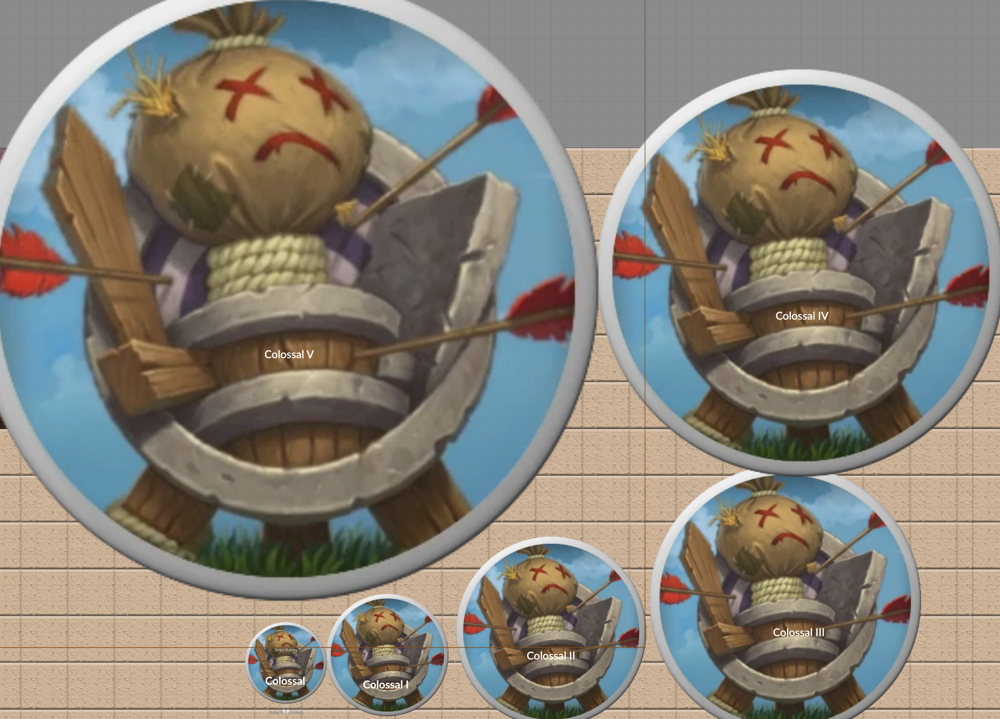

# Victory Size Extension

Pathfinder 1e stops at Colossal. A steam titan the size of a keep does not. Victory Size Extension adds five categories past Colossal, Colossal I through Colossal V, and the system treats them like it always had them.

# What is Victory Size Extension?

This module is an homage to one of my favorite 3.5 settings: DragonMech, a fantasy post apocalyptic world of giant magic mecha, where the machines start at Colossal I and go up. The numbers here are not the book's. Every step is the previous step and half again, so Colossal V is a fight for a very high level party and a 46 square token, not a map you cannot draw. Ninety percent of what you will ever build is Colossal I anyway.

Pick the size from the normal dropdown on the actor sheet or a race item. Attack, AC, CMB, CMD, fly, stealth, carry capacity, reach, the token footprint, and damage dice all follow, because the system reads every one of them off a single size table and this module makes that table longer. Reach is the one hard coded piece, so that gets wrapped. Long stature still drops one row, the way the system already does it.

## Install

Paste this into Foundry's Install Module manifest field:

https://github.com/DatJavaClass/VictorySizeExtension/releases/latest/download/module.json

Enable it. Needs PF1e 11 or later.

## The table

| Size | Atk/AC | CMB/CMD | Fly | Stealth | Carry | Space | Reach tall / long |
| --- | --- | --- | --- | --- | --- | --- | --- |
| Colossal | -8 | +8 | -8 | -16 | x16 | 30 ft | 30 / 20 |
| Colossal I | -12 | +12 | -10 | -20 | x24 | 45 ft | 45 / 30 |
| Colossal II | -18 | +18 | -12 | -24 | x36 | 70 ft | 70 / 45 |
| Colossal III | -27 | +27 | -14 | -28 | x54 | 100 ft | 100 / 70 |
| Colossal IV | -40 | +40 | -16 | -32 | x81 | 150 ft | 150 / 100 |
| Colossal V | -60 | +60 | -18 | -36 | x122 | 230 ft | 230 / 150 |

Carry is the biped multiplier. Quadrupeds get the system's usual half again on top. Damage dice keep climbing the ladder two rungs a size, up to 128d8. Need something bigger than that? You don't.

The same target dummy at every size. Plain Colossal is the small one at the bottom, then counter clockwise up to Colossal V. Click for full size.

## Settings

One client setting, debug mode, which logs the extended tables and every reach lookup past Colossal to the console.

Built and Vibed with AI.

Hippity, Hoppity. My Magic Missiles go Stompity Stompity.
